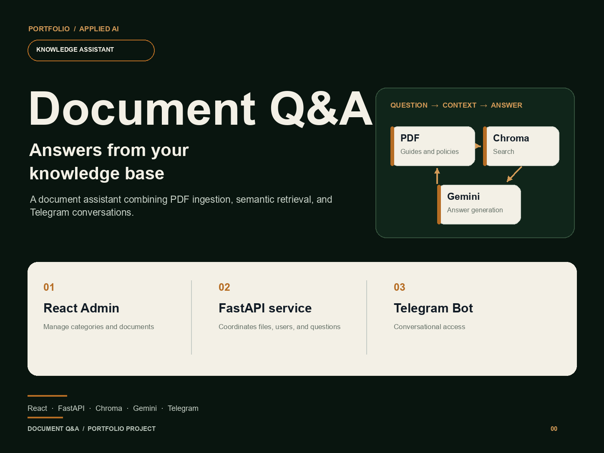
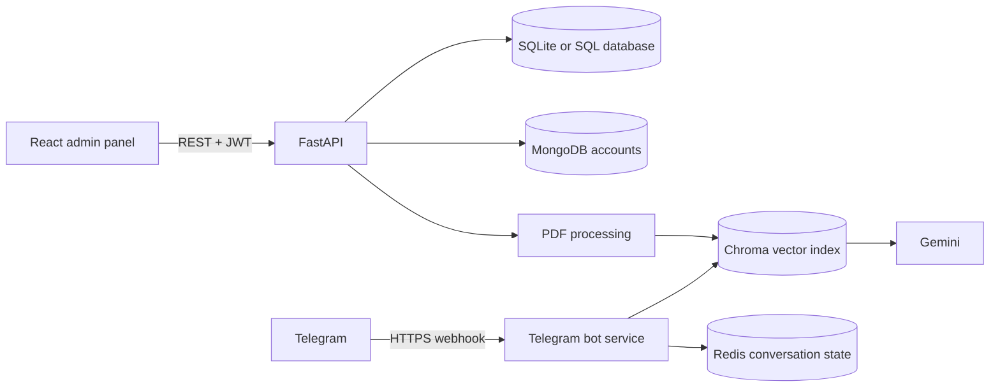
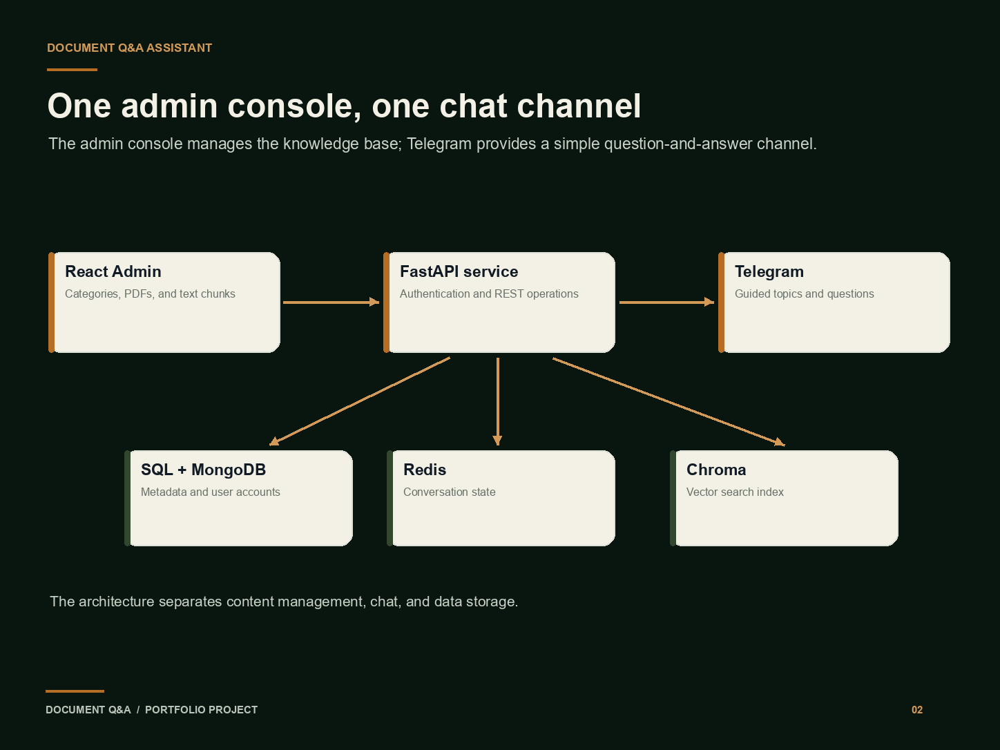

# Document Knowledge Assistant

A document question-answering prototype with a React administration panel, a FastAPI service, semantic PDF retrieval, and an optional Telegram bot. The sample records are fictional and intended for local demonstrations.



## What it does

- Organizes documents with categories and subcategories.
- Lets the user select existing categories/subcategories or enter new ones while uploading a document; the backend creates new labels when the upload is accepted.
- Accepts PDF uploads and extracts text into searchable chunks.
- Stores document metadata in SQL and embeddings in Chroma.
- Retrieves relevant passages and uses Gemini to draft answers.
- Offers an optional Telegram interface with short-lived conversation state in Redis.

## Architecture





| Layer | Main technologies |
|---|---|
| Admin panel | React, Material UI, React Query, Axios |
| API | Python, FastAPI, SQLModel |
| Retrieval | Chroma, LangChain, multilingual sentence embeddings, spaCy |
| Persistence | SQLite by default, MongoDB for accounts, Redis for Telegram sessions |
| Answer generation | Gemini API |

## Requirements

- Windows, macOS, or Linux; use Python 3.11 and Node.js 18 or newer for the commands below.
- npm, Git, and an internet connection for installing packages and downloading language/embedding models.
- SQLite is created locally by default; no separate SQL server is required for a local run.
- MongoDB is needed for registration and login. Set `MONGO_URI` to a local instance or a MongoDB Atlas connection string.
- A Google AI Studio API key is needed for Gemini-powered answers.
- Redis, a Telegram bot token, and a public HTTPS endpoint are needed only for the Telegram bot.

The first PDF-ingestion or retrieval run may download the Spanish spaCy model and the multilingual Hugging Face embedding model. Allow several gigabytes of free disk space for Python packages and model files; CPU inference is supported but can be slow.

## Install and run

Open a PowerShell terminal in this repository.

### 1. Configure and run the backend API

```powershell
Set-Location .\backend
py -3.11 -m venv .venv
.\.venv\Scripts\Activate.ps1
python -m pip install --upgrade pip
$env:PROTOCOL_BUFFERS_PYTHON_IMPLEMENTATION="python"
pip install -r requirements.txt
Copy-Item .env.example .env
```

Generate a unique local JWT signing key:

```powershell
python -c "import secrets; print(secrets.token_urlsafe(48))"
```

Put the generated value in `backend/.env` as `JWT_SECRET_KEY`. Set `MONGO_URI` to your MongoDB instance. Keep `.env` local and never commit it.

Start the API:

```powershell
uvicorn main:app --reload
```

The API is available at `http://localhost:8000`; interactive API documentation is at `http://localhost:8000/docs`. On startup, the service creates the default SQLite tables. Uploaded files and the Chroma index are stored under `backend/storage/` by default.

### 2. Configure and run the frontend

Open a second PowerShell terminal at the repository root:

```powershell
Set-Location .\frontend
Copy-Item .env.example .env
npm ci
npm start
```

The panel starts at `http://localhost:3000`. The frontend reads `REACT_APP_API_URL` from `frontend/.env`; its default is `http://localhost:8000/api`. Register and sign in using a running backend with MongoDB configured.

### 3. Optional Telegram bot

The Telegram bot runs as a separate FastAPI application. It can be deployed to a server or tested locally using ngrok.

#### Configuration

Before starting the bot, configure the following environment variables in `backend/.env`:

- `TELEGRAM_API_KEY`: Telegram bot token.
- `WEBHOOK_SECRET`: Secret token used to validate webhook requests.
- `REDIS_HOST` and `REDIS_PORT`: Redis connection settings.
- `REDIS_USERNAME` and `REDIS_PASSWORD`: Required only if your Redis provider uses authentication.
- `GOOGLE_API_KEY`: Required for Gemini-powered answers.
- `WEBHOOK_URL`: Public HTTPS URL where Telegram can reach the bot, ending in `/webhook`.

The bot does not register its Telegram webhook automatically. You must configure the webhook separately, using the same secret token defined in `WEBHOOK_SECRET`.

#### Option A. Run the bot in a deployed environment

Expose the FastAPI application through a valid HTTPS reverse proxy or tunnel, configure `WEBHOOK_URL`, and register the webhook with Telegram.

From the `backend/` directory, start the application in a separate terminal:

```powershell
uvicorn telegrambot:app --host 0.0.0.0 --port 8001
```

#### Option B. Test the bot locally with ngrok

Use this option to test the bot on your local machine without deploying it to a production server.

**Prerequisites:** Configure `backend/.env`, install ngrok, and authenticate your ngrok account.

**Step 1. Start the ngrok tunnel**

Open a Command Prompt (CMD) window and run:

```powershell
ngrok http 8001
```

Copy the HTTPS forwarding address displayed by ngrok, for example:

```text
https://example.ngrok-free.app
```

Keep the ngrok terminal open while testing.

**Step 2. Update the environment configuration**

In `backend/.env`, set `WEBHOOK_URL` to your ngrok HTTPS address, including the `/webhook` path:

```dotenv
WEBHOOK_URL=https://example.ngrok-free.app/webhook
```

Replace the example URL with your actual ngrok address.

**Step 3. Register the Telegram webhook**

Open a second CMD window and execute the following command, replacing the placeholders with your actual values:

```powershell
curl.exe -X POST "https://api.telegram.org/bot<TELEGRAM_BOT_TOKEN>/setWebhook" -d "url=https://example.ngrok-free.app/webhook" -d "secret_token=<WEBHOOK_SECRET>" -d "drop_pending_updates=true"
```

Replace:
- `<TELEGRAM_BOT_TOKEN>` with the token configured for your Telegram bot.
- `https://example.ngrok-free.app/webhook` with your actual ngrok HTTPS URL followed by `/webhook`.
- `<WEBHOOK_SECRET>` with the same secret configured in `backend/.env`.

A successful response should contain `"ok": true`.

**Step 4. Start the bot**

Open a third CMD window, navigate to `backend/`, activate your virtual environment if applicable, and run:

```powershell
uvicorn telegrambot:app --host 0.0.0.0 --port 8001
```

Keep the terminal open while testing.

**Step 5. Verify the bot**

Open Telegram and send a message to your bot. Check the FastAPI terminal for incoming requests and any errors.

**Important:** Keep both the ngrok tunnel and the FastAPI server running. If ngrok generates a new URL after restarting, update `WEBHOOK_URL` and register the webhook again.

#### Security considerations

Never expose Redis publicly or commit credentials, Telegram bot tokens, or webhook secrets to source control. If a token or secret has been exposed, rotate it before continuing.


## Environment variables and external services

| Variable/service | Needed for | Where to obtain/configure it |
|---|---|---|
| `JWT_SECRET_KEY` | Signing API access and refresh tokens | Generate a private random value locally; use at least 32 bytes |
| `MONGO_URI` | User registration and login | Local MongoDB or a MongoDB Atlas database URI; keep credentials private |
| `DATABASE_URL` | Categories, subcategories, documents, and chunks | Defaults to local SQLite; use a SQLAlchemy-compatible URL for another database |
| `GOOGLE_API_KEY` | Gemini answer generation | Google AI Studio; required for live AI answers, not the mock panel |
| `REDIS_HOST`, `REDIS_PORT`, `REDIS_USERNAME`, `REDIS_PASSWORD` | Telegram conversation state | Local Redis or a Redis provider; credentials depend on the provider |
| `TELEGRAM_API_KEY` | Telegram bot integration | Create a bot with Telegram's BotFather |
| `WEBHOOK_SECRET` | Verifying Telegram webhook requests | Generate a private random token and use the same value in Telegram webhook configuration |
| `WEBHOOK_URL` | Public address used when configuring the bot deployment | Your HTTPS deployment URL; the current bot source does not register this URL automatically |
| `DOCS_DIRECTORY` | Uploaded PDF files | Local path; defaults to `./storage/documents` |
| `CHROMA_PERSIST_DIRECTORY` | Persistent vector index | Local path; defaults to `./storage/chroma` |
| `CORS_ORIGINS` | Allowed browser origins for the API | Comma-separated frontend origins; local default is `http://localhost:3000` |
| `REACT_APP_API_URL` | API address used by React | Local default is `http://localhost:8000/api` |
| `REACT_APP_USE_MSW` | Enable/disable mock API responses in local development | `true` for MSW, `false` for the live backend |

`backend/.env.example` and `frontend/.env.example` contain placeholders and local defaults only. Copy them to `.env` files for your own machine; do not replace the examples with real credentials.

## Frontend demo data (MSW)

The mock API uses fictional seed records stored in `frontend/src/mocks/data/index.js`. It is designed to preview the administration panel without a running API, including a demo sign-in, category/subcategory management, document metadata, and chunk editing. In mock mode, sign in with any valid email and a non-empty password; the mock accepts it locally and creates no real account. Mock changes live only in memory and reset when the browser reloads.

To enable it, edit `frontend/.env`:

```dotenv
REACT_APP_USE_MSW=true
```

Then restart `npm start`. To use the real API, set `REACT_APP_USE_MSW=false`, keep `REACT_APP_API_URL=http://localhost:8000/api` (or your API URL), and restart the frontend. MSW is guarded by the development environment and is not started in production builds.

MSW's sign-in is only a local UI simulation; it does not verify identity or store credentials. MSW does not provide Gemini answers, Telegram, actual PDF storage, or persistent databases. For real login and document ingestion, use the backend and required services. The fake document rows are metadata examples, not included PDF files.

## Repository layout

- `backend/` — API, optional Telegram bot, SQL/Mongo/Redis adapters, PDF processing, and vector search.
- `frontend/` — React administration panel and development-only MSW mock API.
- `reports/social-cards/` — Portfolio graphics.

## Copyright and attribution

Copyright © 2026 Meredith Riofrío. All rights reserved.

This repository is publicly available for portfolio review and professional evaluation.

Unless otherwise stated, no license is granted to reuse, modify, redistribute, or commercially exploit the original project code. All rights not expressly granted are reserved.

### Third-party components

The frontend uses Material Dashboard 2 React v2.2.0 by Creative Tim, distributed under the MIT License. The applicable copyright and permission notices are retained in `frontend/LICENSE.md`.

Third-party dependencies, assets, and other components remain subject to their respective licenses and terms. This notice does not revoke or restrict permissions granted by those licenses.

Author: Meredith Riofrío · [GitHub](https://github.com/MeredithRiofrio)